# Multi-Storey Building Analysis and Concrete Design — STAAD.Pro

A multi-storey reinforced concrete building model created and analysed using STAAD.Pro 2026 (Academic License). This repository contains the STAAD.Pro input model, analysis output, model notes, and screenshots documenting the model, loading conditions, analysis results, and concrete-design outputs.

**Project scope:** This is an academic project for structural modelling and analysis practice. The model and selected software outputs do not establish structural safety or code compliance and should not be used as a construction-ready design.

## Project Overview

The project involves creating a three-dimensional model of a multi-storey RCC building and examining its response to gravity and seismic loading.

The work includes:
- Modelling beams, columns, and plate elements.
- Defining material properties and support conditions.
- Applying dead loads, live loads, and seismic load cases.
- Reviewing member forces, shear forces, bending moments, displacements, deflections, and plate stresses.
- Examining concrete-design outputs for selected beams and columns.

The supplied analysis screenshot reports 0 errors, 5 warnings, and 9 notes. The warnings require review before the results can be relied upon.

## Model Information

| Parameter | Description |
|---|---|
| Software | STAAD.Pro 2026 |
| License | Academic License |
| Structure | Multi-storey reinforced concrete building |
| Approximate plan dimensions | 16 m × 16 m |
| Approximate storey height | 3 m |
| Approximate total height | 21 m |
| Structural elements | Beams, columns, and plates |
| Support conditions | Fixed-base supports shown in the model |
| Seismic definition | IS 1893:2016 load definition shown in the input |
| Concrete design | IS 456 design workflow shown in the screenshots |

These values describe the supplied model. Confirm the dimensions, material properties, and design settings against the current input file before using them for design decisions.

## Load Cases

The screenshots show the following load cases:

- Seismic loading in the global X direction: positive and negative.
- Seismic loading in the global Z direction: positive and negative.
- Dead load.
- Live load.

The actual load definitions, magnitudes, directions, units, and applicable load combinations should be checked in the `.STD` file. The displayed load labels alone do not establish that the seismic setup or load combinations are correct.

## Results Gallery

### 1. Model and Structural Geometry

| Model overview | Rendered structure |
|---|---|
|  |  |

### 2. Seismic Loading

| Seismic load: +X | Seismic load: −X |
|---|---|
| 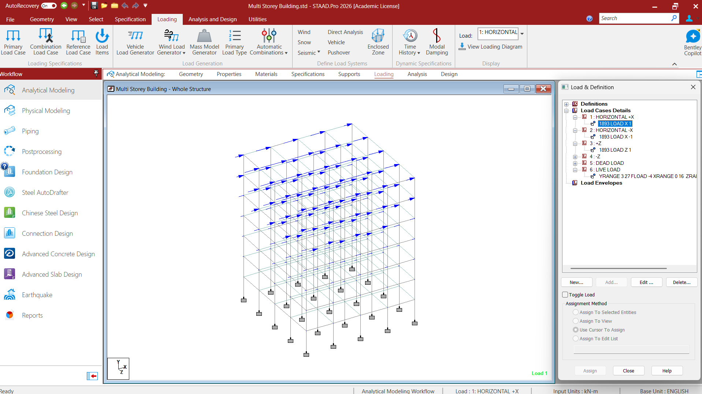 | 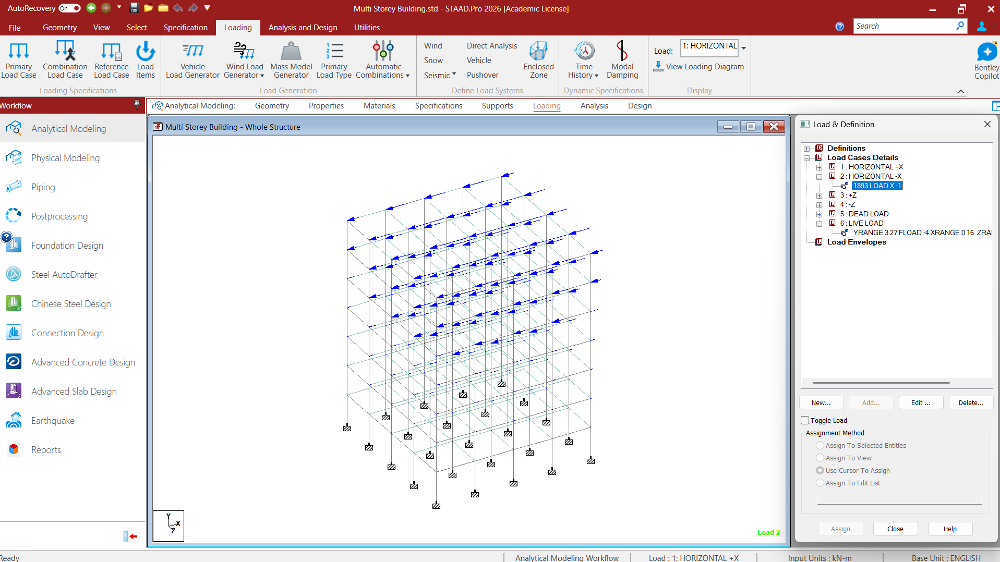 |

| Seismic load: +Z | Seismic load: −Z |
|---|---|
|  | 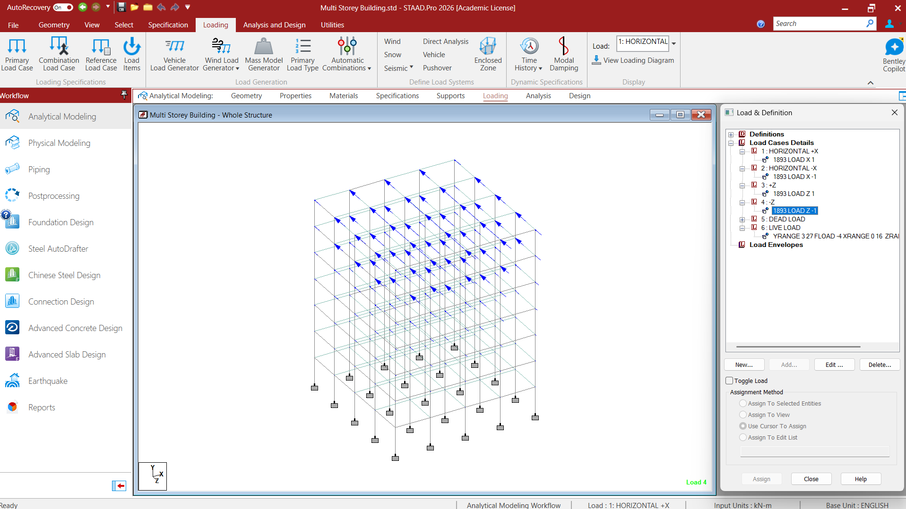 |

### 3. Gravity Loading

| Dead load | Live load / plate load |
|---|---|
| 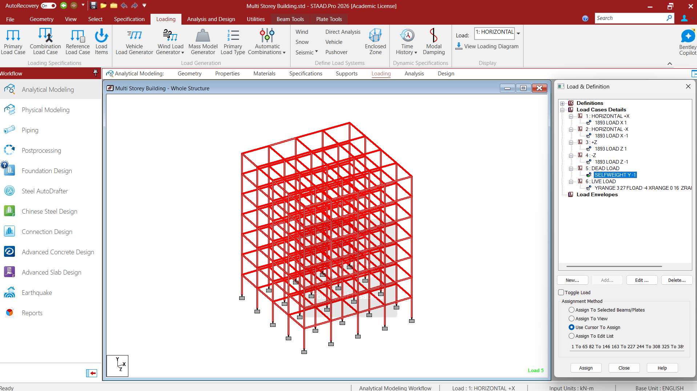 | 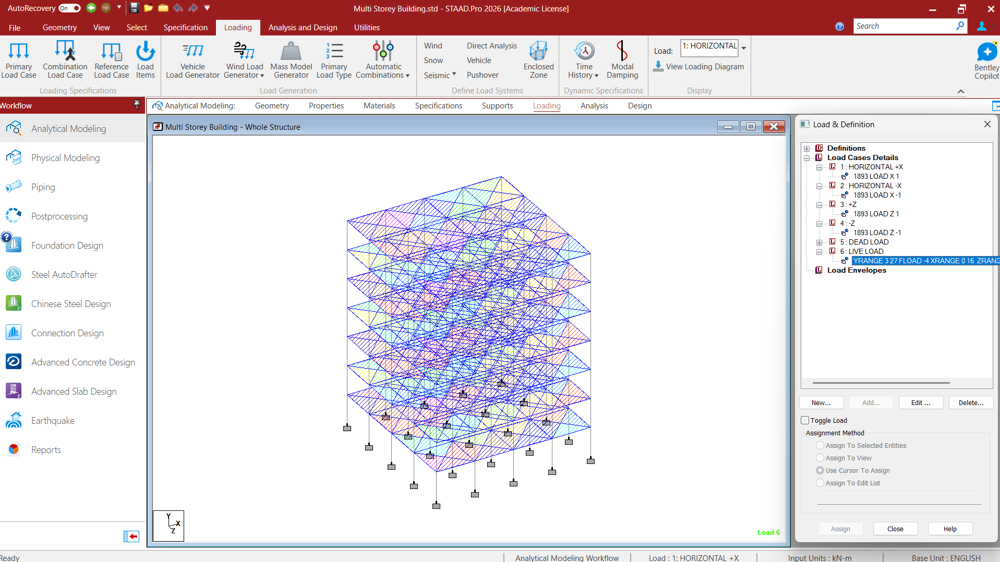 |

### 4. Structural Analysis and Post-Processing

| Beam force results | Beam relative displacement |
|---|---|
| 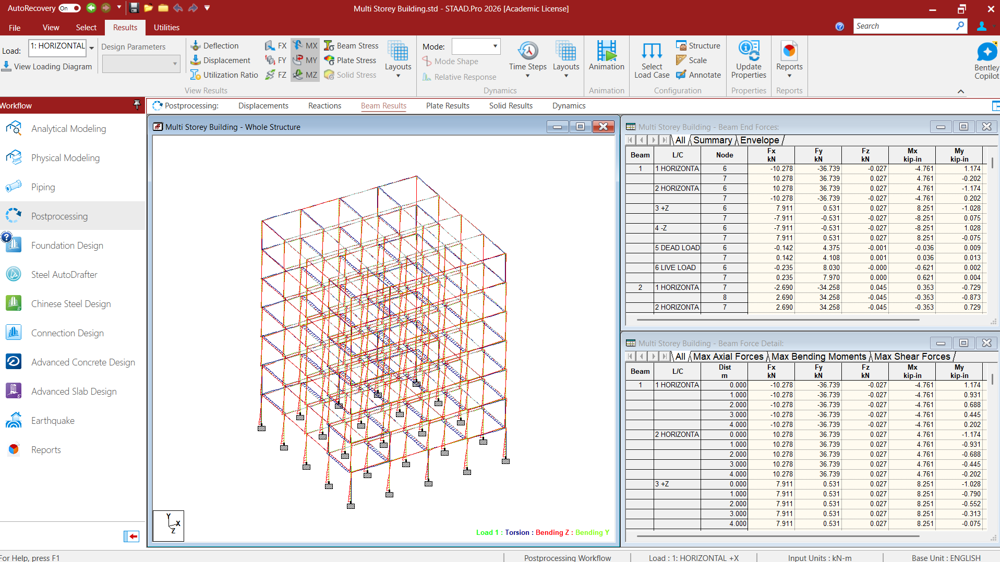 | 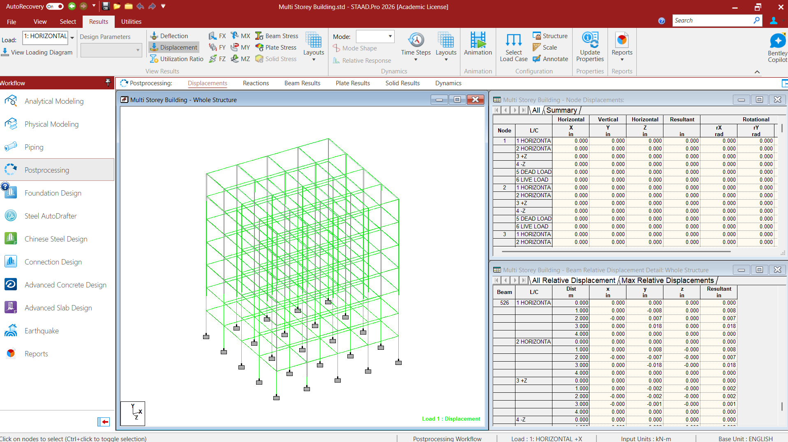 |

| Deflection contour | Plate stress contour |
|---|---|
| 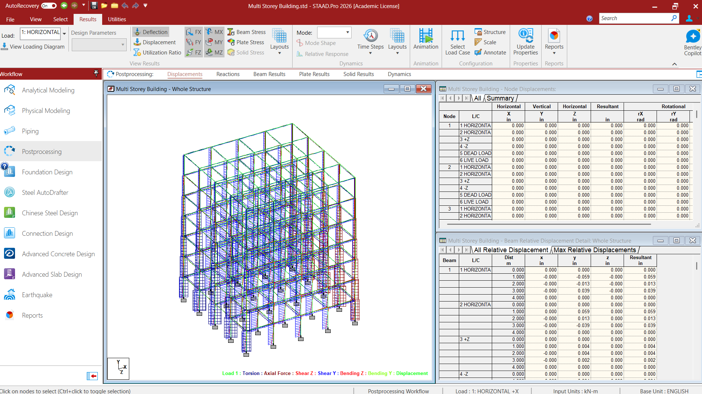 |  |

| Plate displacement contour | Displacement results — overview |
|---|---|
| 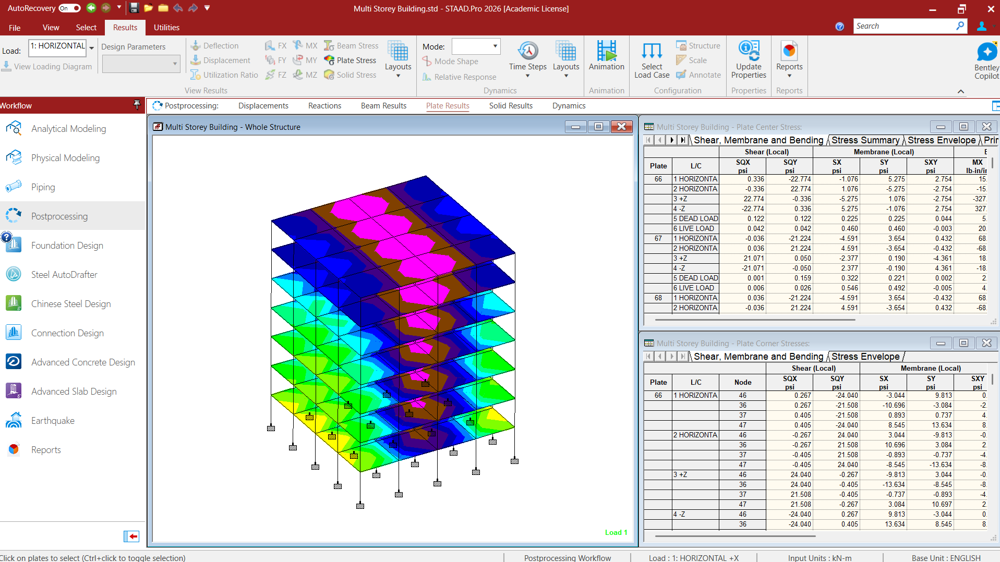 | 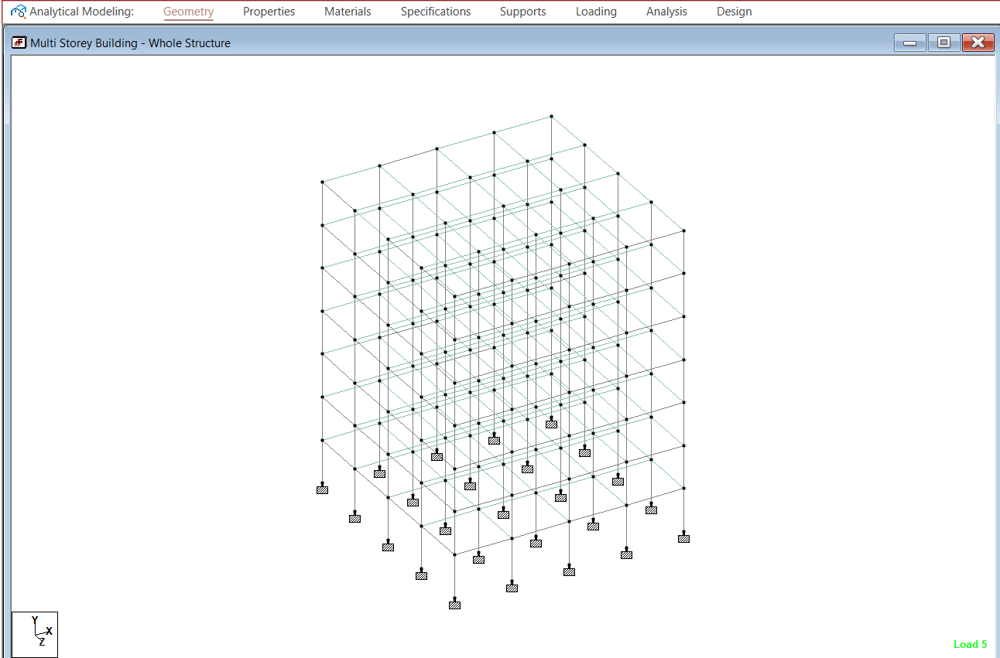 |

| Displacement results — detail | Analysis completion |
|---|---|
| 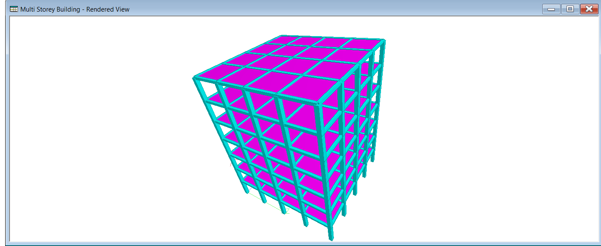 | 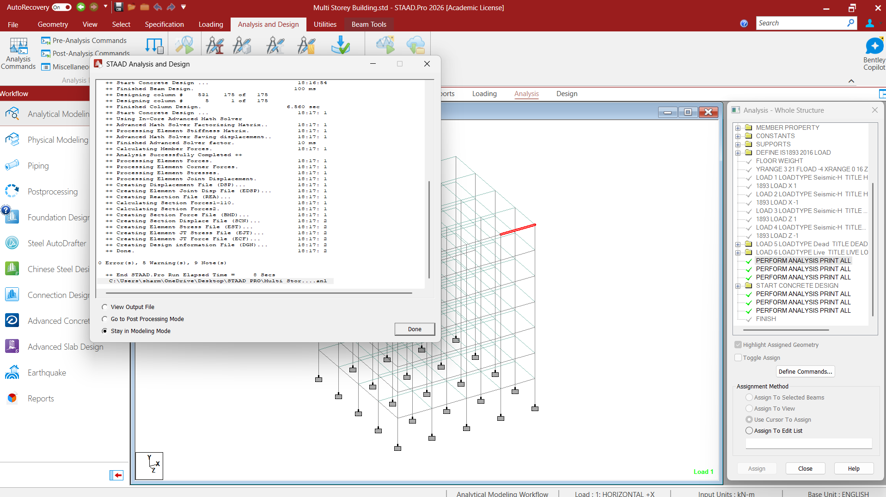 |

### 5. Concrete Design

| Beam 526 design | Column 531 design |
|---|---|
| 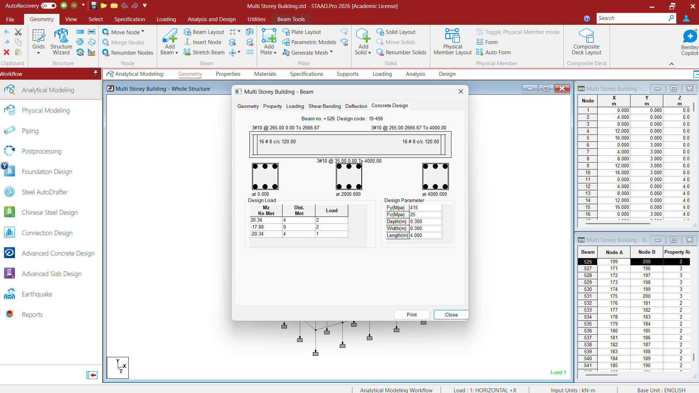 | 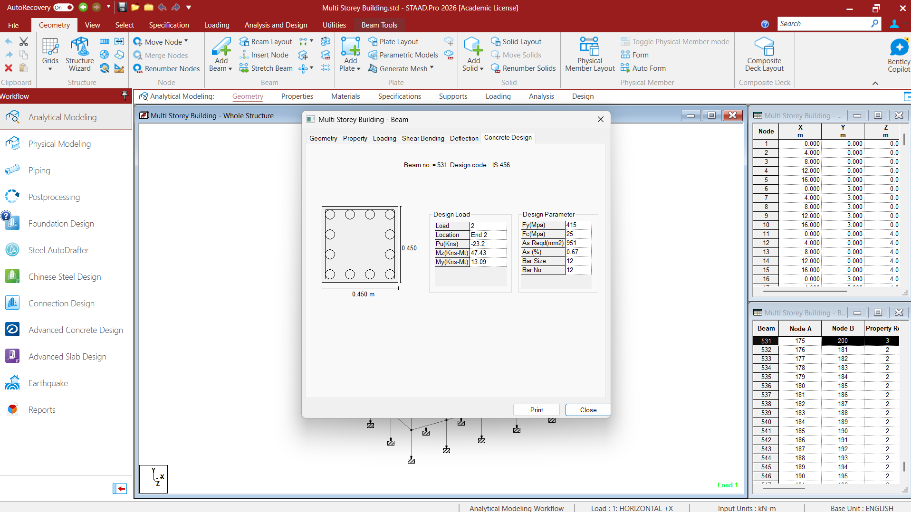 |

The supplied column-design screenshot reports a 450 mm × 450 mm section, steel yield strength of 415 MPa, concrete strength of 25 MPa, a required steel area of 951 mm², and a steel percentage of 0.67%. These values should be verified against the native STAAD.Pro design output before being used in further calculations.

## Repository Contents

```text
Multi-Storey-Building/
├── README.md
├── .gitignore
├── model/
│   └── Multi-Storey-Building.std
├── results/
│   └── Multi-Storey-Building.anl
└── docs/
    ├── MODEL_NOTES.md
    ├── model-preview.png
    └── images/
        ├── model-overview.png
        ├── rendered-structure.png
        ├── seismic-load-x-positive.png
        ├── seismic-load-x-negative.png
        ├── seismic-load-z-positive.png
        ├── seismic-load-z-negative.png
        ├── dead-load.png
        ├── live-load-plate-load.png
        ├── beam-force-results.png
        ├── beam-relative-displacement.png
        ├── deflection-contour.png
        ├── plate-stress-contour.png
        ├── plate-displacement-contour.png
        ├── displacement-results-overview.png
        ├── displacement-results-detail.png
        ├── analysis-completion.png
        ├── beam-526-design.png
        └── column-531-design.png
```

## How to Run the Model

1. Install a compatible licensed version of STAAD.Pro.
2. Open `model/Multi-Storey-Building.std`.
3. Review the geometry, member and plate properties, material definitions, and support conditions.
4. Check the units, load magnitudes, seismic parameters, and applicable load combinations.
5. Run the analysis and examine the output and warnings.
6. Review the concrete-design results for the selected members.
7. If the model is modified, save the updated output and replace the screenshots with results from the same model version.

STAAD.Pro is proprietary software. This repository does not include the software or grant a licence to use it.

## Verification Checklist

Before relying on the model results:

- Verify seismic load directions and parameters against the applicable code and project assumptions.
- Review all five reported warnings and determine whether they affect the model or results.
- Confirm material strengths and units.
- Check load magnitudes, load application, and tributary areas.
- Define and verify the applicable load combinations.
- Check maximum storey drift and overall displacement against applicable limits.
- Review beam and column design forces, reinforcement requirements, and pass/fail status.
- Confirm that the design screenshots correspond to the final model and output.
- Obtain independent professional review before any real-world use.

## Limitations

This repository documents an academic structural modelling and analysis exercise. It is not a complete structural design report and does not include independent verification of every design assumption, foundation design, construction detailing, or professional approval.

Any real-world application would require appropriate engineering checks and independent review by a qualified structural engineer.

## Software and Licensing

The model was prepared using STAAD.Pro 2026 Academic License. STAAD.Pro remains proprietary software. No open-source licence is applied to Bentley software or its components. Any separate licence for the original model or documentation should be added only after confirming the relevant rights.
