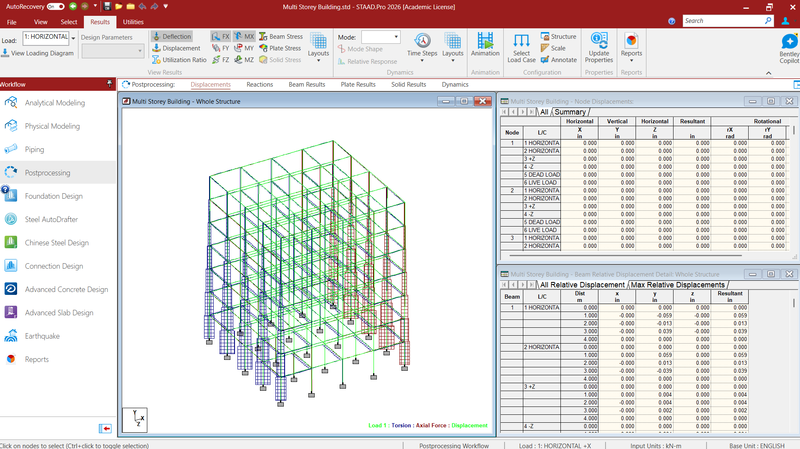
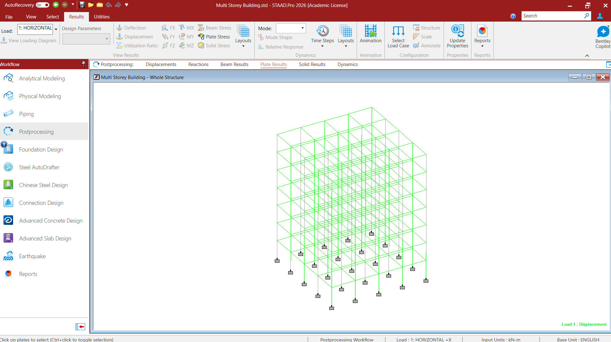

# Multi-Storey Building Analysis and Concrete Design — STAAD.Pro

A multi-storey reinforced concrete building model created and analysed using STAAD.Pro 2026 (Academic License). This repository contains the STAAD.Pro input model, analysis output, model notes, and screenshots documenting the modelling process and analysis results.

**Note:** This is an academic project intended for learning and demonstration. The model and selected software outputs do not establish structural safety or code compliance and should not be treated as a construction-ready design.

## Project Overview

The project involves modelling a multi-storey RCC building and examining its structural response under gravity and seismic loading.

Key activities include:
- Creating a 3D model using beams, columns, and plate elements.
- Defining material properties and support conditions.
- Applying dead loads, live loads, and seismic load cases.
- Examining member forces, bending moments, displacements, deflections, and plate stresses.
- Reviewing concrete-design results for selected beams and columns.

The supplied analysis screenshot reports 0 errors, 5 warnings, and 9 notes. The warnings should be reviewed before relying on the results.

## Model Information

| Parameter | Description |
|---|---|
| Software | STAAD.Pro 2026 |
| License | Academic License |
| Structure | Multi-storey reinforced concrete building |
| Approximate plan dimensions | 16 m × 16 m |
| Approximate storey height | 3 m |
| Approximate total height | 21 m |
| Structural elements | Beams, columns, and plates |
| Support conditions | Fixed-base supports shown in the model |
| Seismic definition | IS 1893:2016 load definition in the input |
| Concrete design | IS 456 design workflow shown in the screenshots |

These values describe the supplied model and should be confirmed against the current input file before being used for design decisions.

## Load Cases

The screenshots show the following load cases:
- Seismic loading in the global X direction, positive and negative.
- Seismic loading in the global Z direction, positive and negative.
- Dead load.
- Live load.

The load definitions, magnitudes, directions, units, and applicable load combinations should be checked in the STAAD.Pro input file before interpreting the results.

## Results Gallery

### Model and Loading

| Model overview | Rendered structure |
|---|---|
|  |  |

Include the existing screenshots for seismic loading in X and Z, dead load, and live load in this section, using their original filenames.

### Analysis and Post-Processing

Include the existing screenshots showing:
- Beam end forces and beam forces.
- Beam relative displacement.
- Deflection contours and plate stress contours.
- Nodal displacement results.
- Analysis completion summary.

Use each original image path once and give each image a caption that matches its contents.

### Concrete Design

The concrete-design screenshots show the results for beam 526 and column 531.

The supplied column-design screenshot reports a 450 mm × 450 mm section, steel yield strength of 415 MPa, concrete strength of 25 MPa, a required steel area of 951 mm², and a steel percentage of 0.67%. These values should be checked against the native STAAD.Pro design output before being used in further calculations.

Retain the existing screenshots for both members, using their original filenames.

## Repository Contents

```text
Multi-Storey-Building/
├── README.md
├── .gitignore
├── model/
│   └── Multi-Storey-Building.std
├── results/
│   └── Multi-Storey-Building.anl
└── docs/
    ├── MODEL_NOTES.md
    ├── model-preview.png
    └── images/
        └── Existing model, loading, analysis, and design screenshots
```

## How to Run the Model

1. Install a compatible licensed version of STAAD.Pro.
2. Open `model/Multi-Storey-Building.std`.
3. Review the geometry, member and plate properties, materials, supports, and load definitions.
4. Check the units, seismic parameters, and applicable load combinations.
5. Run the analysis and review the output and warnings.
6. Review the concrete-design results. If the model changes, update the saved output and relevant screenshots.

## Limitations

This repository documents an academic structural modelling and analysis exercise. It is not a complete structural design report and does not include independent verification of every design assumption, foundation design, construction detailing, or professional approval.

Any real-world application would require appropriate engineering checks and independent review by a qualified structural engineer.

## Software

The model was prepared using STAAD.Pro 2026 Academic License. STAAD.Pro is proprietary software; this repository does not include the software or grant a licence to use it.